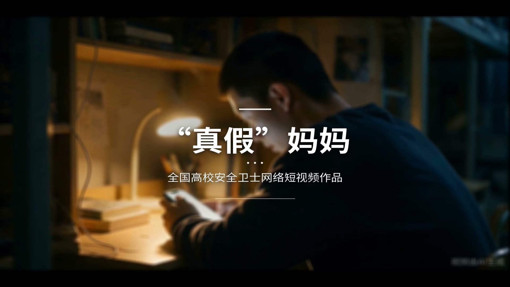
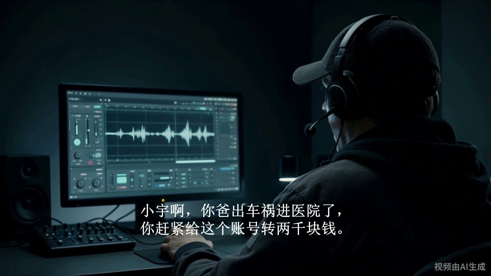

# 真假妈妈 · AI 反诈科普短片

> **一部 56 秒、全流程 AI 参与制作的反诈科普短片。**
> 故事只有一个转折：电话那头喊你「儿子」的妈妈，可能不是妈妈。
>
> 🏫 参展作品 · **全国高校「安全卫士」网络短视频征集展示**（#校园网络文明月#）

[](#)
[](#)
[](#)
[](#-许可)

**English** — *A 56-second Chinese anti-fraud PSA made end-to-end with AI: AI-generated footage, neural TTS voice acting, auto-mixed audio and burned-in subtitles. It targets the "fake relative phone call" scam. Docs, prompts, subtitles and the full reproducible toolchain are open-sourced here.*

---

## 预览

| 开场 · 陌生来电 | 诈骗 · 骗子施压 |
| :--: | :--: |
|  |  |
| **反转 · 真妈妈来电** | **片尾 · 96110 警示** |
|  |  |

> 完整成片（56.30s / 30.8 MB）体积较大，未纳入 Git 历史，请见 **[RELEASES.md](RELEASES.md)** 获取。

---

## 故事

7 个镜头，一个电话，一次差点转出去的两千块。

| 镜 | 内容 |
| :-: | :-- |
| 1 | 男主接到「妈妈」来电，滑动接听 |
| 2 | 左右分屏：男主接听 ／ 骗子在另一头假扮母亲 |
| 2a | 男主起疑：「你谁呀？」 |
| 3 | 骗子施压诱骗，催促转账 |
| 4 | 男主起身踱步、焦躁，忽然想起反诈宣传 —— 回座拨号核实 |
| 7 | 真妈妈接通电话，一句「没啥事啊」拆穿骗局 |
| 8 | 男主挂断、释然，片尾打出 96110 与警示语 |

---

## 制作流程

```
剧本分镜  →  Seedance 生成画面  →  PIL 渲染 UI 素材  →  讯飞超拟人 TTS 配音
   →  FFmpeg 处理与混音  →  Shotcut (melt/MLT) 合成  →  烧入硬字幕  →  成片
```

全程**零版权争议**：画面为 AI 生成、配音为自研 TTS、配乐为 CC0 公共领域、字体为 OFL，详见 [素材来源与授权](docs/02_配音与字幕/素材来源与授权.md)。

---

## 技术栈

| 环节 | 工具 |
| :-- | :-- |
| 画面生成 | Seedance（文生视频 / 图生视频） |
| UI 素材 | Python + Pillow（来电界面、转账界面、96110 弹窗等 17 张） |
| 语音合成 | 讯飞「超拟人语音合成」WebSocket API（HMAC-SHA256 鉴权） |
| 音视频处理 | FFmpeg（裁切、分屏、drawtext、混音、volumedetect 校验） |
| 剪辑合成 | Shotcut / melt（MLT XML 工程） |
| 字幕 | SRT / ASS（Noto Sans SC），FFmpeg subtitles 滤镜烧入 |
| 脚本语言 | Python 3 |

---

## 目录结构

```
anti-fraud-short-video/
├── README.md                  本文件
├── RELEASES.md                大体积成片 / 音频的获取说明
├── LICENSE                    代码许可（MIT）
├── LICENSE-CONTENT.md         内容许可（CC BY-NC 4.0）
├── docs/
│   ├── 01_创作方案/            分镜工程表 v12（定稿）、工具方案、操作手册
│   ├── 02_配音与字幕/          配音工作流、音频清单、素材授权、交付说明
│   ├── 03_合成与验收/          各镜验收记录、版本说明
│   ├── 04_提示词/              Seedance 逐镜提示词 + 8 镜脚本
│   └── 公开发布指南.md         发布与投稿注意事项
├── scripts/                   全部可复用脚本
│   ├── xfyun_tts.py           讯飞 TTS 客户端（命令行）
│   ├── _melt_字幕配音合成.py    一键：混音 → 铸字 → 出片
│   ├── _gen_subtitles_v12.py  由时间轴生成 SRT / ASS
│   ├── _gen_ringtone.py       参数化合成原创电话铃声
│   ├── _render_ui.py          渲染 UI 素材
│   └── mux_to_video.py        音轨与画面封装
├── subtitles/                 成片字幕（SRT / ASS / NotoSansSC）
├── config/
│   └── xfyun_config.example.json   ★ 脱敏模板（复制后填自己的密钥）
├── data/
│   ├── 时间轴_v12.json         每句人声的起止时间
│   ├── 配音台词表_v12.json      台词与音色映射
│   └── 配音清单_manifest.json   15 条人声的合成参数记录
├── project/
│   └── 真假妈妈_v12.7_字幕配音工程.mlt   Shotcut 工程文件
└── assets/
    ├── ui/                   17 张 UI 素材（Pillow 渲染）
    ├── voice/                15 条人声（AI 合成，可直接复现合成）
    ├── audio/                原创铃声 + 试听
    └── preview/              README 预览帧
```

---

## 快速开始

### 0. 获取大文件

成片与音频素材通过 Releases 分发，请先按 **[RELEASES.md](RELEASES.md)** 下载并放置到对应目录。

### 1. 环境

```bash
python -V            # Python 3.9+
pip install requests pillow
ffmpeg -version      # 需在 PATH 中
```

### 2. 配置语音合成

```bash
cp config/xfyun_config.example.json xfyun_config.json
# 编辑 xfyun_config.json，填入讯飞控制台的 appid / api_key / api_secret
```

> `xfyun_config.json` 已在 `.gitignore` 中，不会被提交。**请勿把它推送到任何公开仓库。**

### 3. 从台词生成配音

```bash
python scripts/xfyun_tts.py --help
```

### 4. 合成成片

```bash
# 混音 → 烧字幕 → 出片
python scripts/_melt_字幕配音合成.py render
```

---

## 关于路径占位符

为保护隐私，脚本与文档中所有本机绝对路径已替换为占位符：

| 占位符 | 含义 | 你需要改成 |
| :-- | :-- | :-- |
| `<PROJECT_ROOT>` | 素材工作目录（含源画面、配音、UI 素材等） | 你的实际路径 |
| `<WORKSPACE>` | 工作区根目录 | 你的实际路径 |
| `<HOME>` | 用户主目录 | 你的实际路径 |

一次性替换即可让脚本运行：

```bash
grep -rl '<PROJECT_ROOT>' . | xargs sed -i 's|<PROJECT_ROOT>|/your/actual/path|g'
```

---

## 素材来源与授权

| 类型 | 来源 | 授权 |
| :-- | :-- | :-- |
| 画面 | Seedance AI 生成 | 自制，可自由使用 |
| 配音 | 讯飞超拟人语音合成，台词自撰 | 自制 |
| 电话铃声 | 本项目参数化合成（`_gen_ringtone.py`） | 自制 |
| 背景音乐 A/B | FreePD（Kevin MacLeod） | **CC0 1.0** 公共领域 |
| 字体 | Noto Sans SC / 思源黑体 | **SIL OFL 1.1**（允许嵌入与分发） |

> 说明：本项目**未使用**任何以「Apple 版权铃声」为来源的音频文件。

---

## AI 生成内容标识

依据《人工智能生成合成内容标识办法》：

- 成片画面**全程带常驻 AI 生成水印**；
- **片尾打有「本作品为 AI 辅助制作」声明**；
- 配音为 AI 合成语音。

二次发布时请勿移除上述标识。

---

## 免责声明

本片为**反诈科普公益作品**，剧情与人物均为虚构，与任何真实机构、个人无关。
片中的「96110」为全国反诈专线，「国家反诈中心 App」为官方应用 —— 作品本身不代表任何官方立场。如遇疑似诈骗，请立即拨打 **96110** 或报警。

---

## 许可

- **代码**（`scripts/` 等）：[MIT](LICENSE)
- **内容**（文档、字幕、提示词、UI 素材、成片）：[CC BY-NC 4.0](LICENSE-CONTENT.md) —— 允许署名非商业使用

---

## 参赛背景

本仓库是《真假妈妈》参加 **全国高校「安全卫士」网络短视频征集展示**（教育部思想政治工作司指导 · 中国大学生在线主办）的完整创作档案。
作品按活动格式要求制作，逐条核对：

| 活动要求 | 本片 | |
| :-- | :-- | :-: |
| 时长 **≤ 1 分钟** | 56.30s | ✅ |
| 分辨率 **≥ 1920×1080** | 1920×1080 | ✅ |
| 格式 MP4 / ≤ 600MB | 30.8 MB | ✅ |
| 内容配字幕 | 13 条硬字幕 | ✅ |
| 原创、无版权纠纷 | CC0 音乐 ＋ 原创铃声 ＋ OFL 字体 ＋ AI 画面 | ✅ |

活动明确「鼓励使用人工智能等新技术进行创作」——本片正是全流程 AI 参与制作的实践。
若你也想参加类似活动，请以活动最新通知为准。
